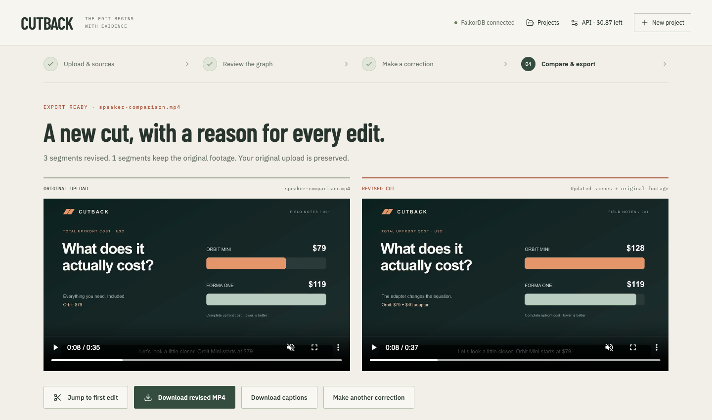
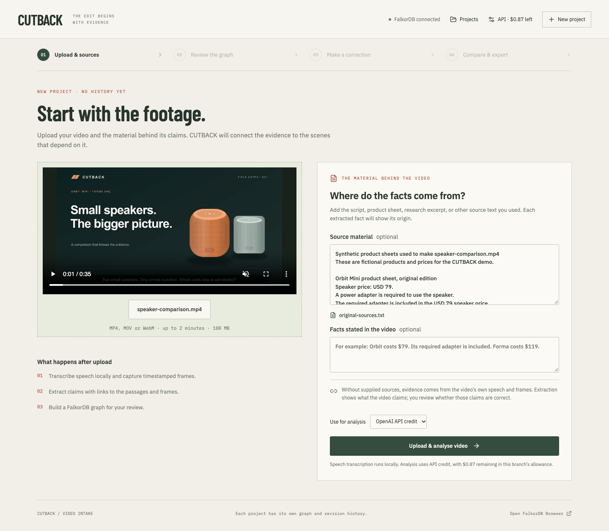
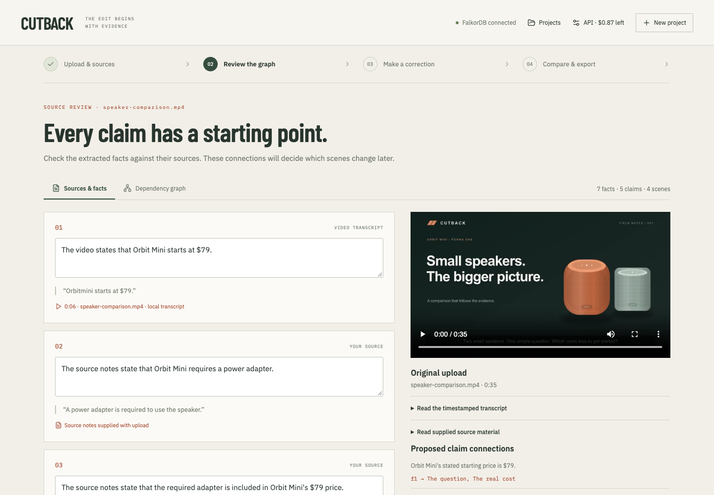
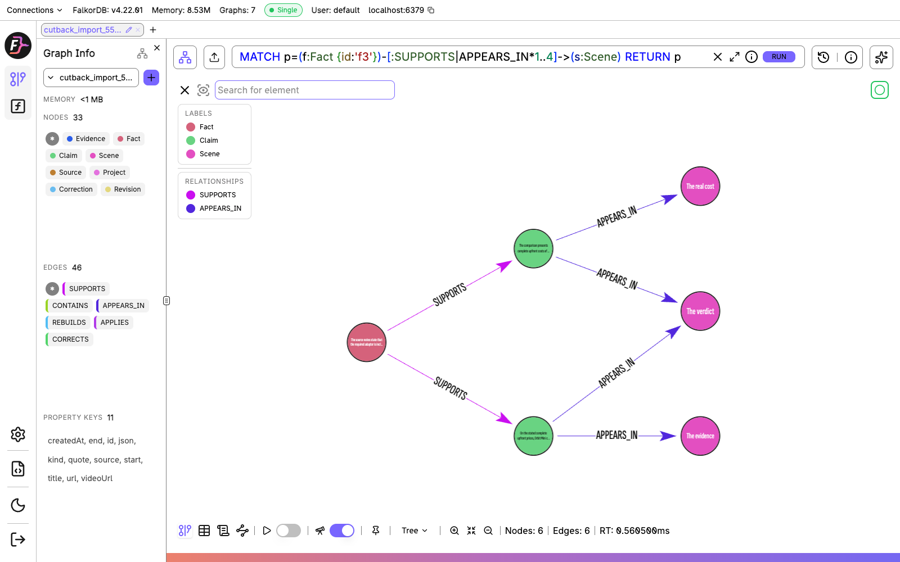
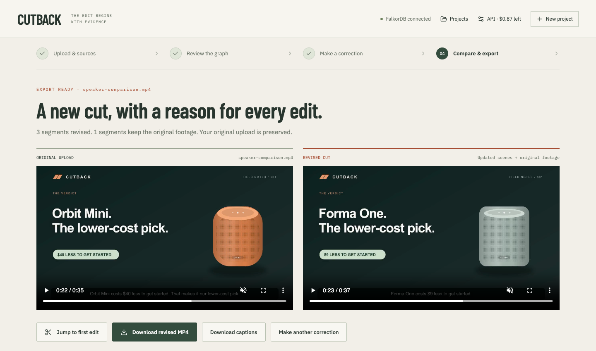

# I built CUTBACK to fix a video without recording it all again

Have you ever finished recording a video, only to realise that one of the facts in it needs to change?

Maybe a price was wrong. Maybe a product needs an accessory you thought was included. You can replace the sentence where you mention it, but that sentence might also support a chart, a comparison, and the recommendation at the end.

Now you have to find all of them. Then record new audio, update the graphics, check the captions, and make sure the ending still makes sense.

That was the problem I wanted to work on with CUTBACK. I built it for the FalkorDB hackathon's **Agents That Act on Connected Data** track. It takes a video and its source material, connects the claims in the video to their evidence, and uses those connections to decide which scenes need to change when a fact changes.

The output is another playable video. I can compare it with the original and inspect why each scene was selected for an edit.

## One missing adapter changes the recommendation

I used a short comparison of two fictional speakers to make the problem concrete.

Orbit Mini starts at $79. Forma One costs $119 with everything required to use it. The original source sheet says Orbit's required power adapter is included, so the video recommends Orbit as the cheaper option. The difference is $40.

Then I introduce a revised source sheet. The adapter is actually sold separately for $49.

The new calculation is straightforward:

```text
Orbit Mini: $79 + $49 = $128
Forma One:              $119
Difference:              $9
```

Forma becomes the cheaper choice. Updating the $79 label alone would leave the video recommending the wrong speaker.

CUTBACK follows the adapter assumption to the cost comparison and the verdict. In the revised film, the chart shows $128 against $119, and the recommendation changes to Forma. The narration and captions use the new figures too.



_The original chart treats Orbit as a $79 complete purchase. The revised chart includes the $49 adapter._

I kept the products and source sheets fictional so the entire example could be uploaded, inspected, and shared with the repository.

## Starting with an upload and its sources

My first demo opened on an already prepared film and graph. That made the result easy to show, but left an obvious question: where had the information come from?

I changed the application to start with an empty project. I upload the MP4 and attach the original source sheets used by the video. The later correction is supplied separately, after reviewing the original claims.



_The two inputs are visible before analysis: the film and the source material behind it._

The backend extracts the audio and runs Whisper locally to produce timestamped speech passages. It also samples video frames. The OpenAI model receives those passages, the frames, and the source text, then proposes facts and the claims that depend on them.

There are several different objects here. A source is the uploaded video or the supplied document. Evidence is a particular speech passage, sampled frame, or document passage. A fact is an underlying assertion, such as “the adapter is included.” A claim is something the video says on the strength of those facts, such as “Orbit costs $40 less.” A scene is the interval of the film where a claim appears.

The latest fresh-upload run produced seven facts and five claims across four scenes. Those counts belong to that run; the extraction is model-generated and can vary.

I added a review step before letting the agent act. Each fact shows its quoted passage and whether it came from the transcript, a video frame, or my source material. Speech timestamps let me jump back into the original film.



_A fact has a source to check. It is still an extracted assertion, not an independently verified truth._

For text evidence, the server checks that the quoted passage occurs in the cited source. It also rejects links to missing facts or scenes. These checks catch broken references. They cannot establish that a source is correct or that every inferred dependency is sensible. I still need to review those connections.

## Using FalkorDB to choose the edit scope

The upload version stores this structure in FalkorDB:

```text
Source ─CONTAINS→ Evidence ─SUPPORTS→ Fact
Fact ─SUPPORTS→ Claim ─APPEARS_IN→ Scene
```

The adapter fact can support several claims. A claim can appear in several scenes. When I change the fact, I need to follow those relationships and collect the affected scenes.

This is the traversal used by the application's impact tool:

```cypher
MATCH p=(f:Fact {id:$factId})
        -[:SUPPORTS|APPEARS_IN*1..4]->(s:Scene)
RETURN s.id AS id,
       [n IN nodes(p) | n.title] AS path
```

It starts at the selected fact and follows outgoing `SUPPORTS` and `APPEARS_IN` relationships. The `*1..4` allows paths containing one to four relationships; the current fact-to-claim-to-scene paths use two.

I return the path as well as the scene ID because I want to explain the result. “Rebuild the verdict” is more useful when I can see which assumption and claim caused it to be included. The application deduplicates scene IDs when multiple paths reach the same scene.

Each upload gets a separate graph named `cutback_import_<project ID>`. That keeps a rehearsal's facts and exports out of the next project's history. A small index graph holds the project list.

The backend uses the [FalkorDB JavaScript client](https://github.com/FalkorDB/falkordb-ts). In the store, the selected fact is passed separately as a query parameter:

```typescript
const result = await db.selectGraph(graphName).query(impactQuery, {
  params: { factId },
  TIMEOUT: 10000,
});
```

The returned scene IDs become the permitted edit set. The server rejects a plan that adds an unrelated scene or omits an affected one. It queries FalkorDB again immediately before rendering and checks the plan against that result.

I tested this by removing a dependency edge in an isolated test graph. The corresponding scene disappeared from the allowed set. The graph therefore changes what the application can do, as well as what its interface displays.

## Opening the same graph in FalkorDB Browser

I wanted to show the stored relationships outside my own interface, so I also used [FalkorDB Browser](https://github.com/FalkorDB/falkordb-browser), the visual client.

In my local setup, the upload app connects to the database on port `6397`, and Browser opens on `6398`. Browser's connection form uses `localhost:6379` because it reaches the database inside the container. The Node application uses the host-mapped port.

After selecting the project's graph, I can run:

```cypher
MATCH p=(f:Fact {id:'f3'})
        -[:SUPPORTS|APPEARS_IN*1..4]->(s:Scene)
RETURN p
```

Here, `f3` is the adapter-included fact in my latest upload. Fact IDs can differ between runs. Returning `p` gives Browser the complete paths to draw.



_This run's graph reaches the cost scene, verdict, and closing scene. The extra closing-scene dependency exposed an extraction issue described below._

For a list of distinct affected scenes, I use:

```cypher
MATCH (f:Fact {id:'f3'})
      -[:SUPPORTS|APPEARS_IN*1..4]->(s:Scene)
RETURN DISTINCT s.id AS sceneId,
                s.title AS scene
```

These are read-only queries. Opening the graph and inspecting the result does not make a model request.

## Giving the agent tools and a boundary

The editing workflow uses one model-driven agent with four MCP tools:

- `trace_impact` queries FalkorDB for the affected scenes and dependency paths.
- `read_affected_scenes` supplies the relevant scenes, claims, facts, and source passages.
- `calculate` performs addition and subtraction, using cents for the price comparison.
- `submit_edit_plan` submits the proposed scene titles, narration, and reasons.

The MCP client and server communicate through an in-process transport. The client discovers the tool schemas, and the application supplies those definitions to the OpenAI Responses API. When the model requests a function call, the application dispatches it through the MCP client and returns the tool result.

In the completed fresh-upload run, the activity log records impact tracing, a scene read, two calculator calls, and plan submission. The agent adds 7,900 and 4,900 cents, then compares the result with 11,900 cents.

I enforce the order where it matters. The agent must trace the impact before reading the affected scenes, and it must perform both steps before submitting a plan. The submitted scene IDs must match the graph result exactly. The planning loop also has a five-turn limit.

For the speaker film, the final chart values and narration are compiled from the corrected prices using its editable layouts. That keeps the displayed total, spoken total, and winner consistent. General uploads still need a person to review the proposed prose; matching the graph's edit scope does not prove that every sentence is correct.

Once the plan is ready, I review it and approve the render.

## Why I removed the correction cards

The first upload implementation replaced affected segments with labelled correction cards and synthetic narration. The information was updated, but the result felt like an interruption to the film.

I wanted the revised comparison to work as a complete video. Its cost scene should show the new costs. Its verdict should recommend the right speaker. The source trail can remain available in the application without being read aloud in the film.

I changed the renderer to rebuild the speaker film's existing chart and illustration layouts. It keeps the colours, typography, speaker drawings, and local narration voice. The revised verdict now says:

> Forma One costs $9 less to get started. That makes it our lower-cost pick.



_The recommendation changes with the total cost. There is no correction announcement inserted into the film._

The implementation is deliberately specific about visual reconstruction. The supplied speaker film has editable layouts, recognised by the uploaded file's SHA-256 fingerprint. Renaming an unrelated file to match the demo filename will not select them. The fingerprint identifies the rendering layout and cut points; a fresh project's facts and dependencies still come from analysis of its inputs.

Other uploaded videos use editorial replacement scenes with local synthetic narration. This prototype does not reconstruct arbitrary footage, clone a speaker's voice, or change a filmed person's lip movements.

For rendering, Sharp converts SVG layouts into PNG frames. Local speech synthesis produces the narration, and FFmpeg assembles H.264 video with AAC audio. The export also includes SRT captions. Caption timing is estimated within segments; I have not implemented word-level alignment.

Scenes outside the affected set retain their uploaded footage and audio, with format normalization for the final MP4. The original upload and earlier exports remain available.

## A correct price can still produce a bad cut

One problem appeared before I got to the model's reasoning: the initial automatic segmentation cut through the middle of the cost scene.

The first three-segment split ended the opening segment at about 11.32 seconds. But the authored film's cost scene starts at about 6.917 seconds. Preserving that first segment would preserve several seconds of the old price graphic, even if the later replacement scene showed the right total.

I fixed the bundled film's segmentation by using its actual four scene boundaries. That lets the renderer replace the complete cost scene and the complete verdict.

The fresh-upload run exposed a second, related problem. Whisper placed the verdict passage between 20.52 and 26.10 seconds, while the closing scene begins at 25.75 seconds. My extractor currently attaches a whole passage to any scene it overlaps. That gave the closing scene some verdict text as input to the model.

The resulting graph linked the recommendation to the closing scene. FalkorDB returned three distinct scenes, and the renderer rebuilt all three. The closing narration remained the same because its editable layout contains the scope and fictional-product disclosure.

That run followed its stored graph, but the graph was broader than the intended edit. The earlier aligned example selected only the cost and verdict scenes. I cannot treat that two-scene result as a guarantee for fresh extraction.

This is the next part I want to improve: word-level timing, better claim-to-scene checks, and an editor for reviewing dependency edges. The current review screen lets me inspect the connections and adjust fact wording, but it does not yet let me repair individual edges.

## Keeping the demo usable while changing it

The upload flow was a substantial change, so I developed it in a separate Git worktree with its own app port, FalkorDB port, Browser port, data directory, and Docker volume. The earlier demo could keep running while I changed the new workflow.

That also solved a presentation problem. Rehearsing the original application accumulated many video versions. A new upload now creates a new project with no inherited exports. Earlier attempts stay behind the Projects button, where I can reopen them if needed.

I added a path for reusing a reviewed speaker-film analysis when changing its presentation. It copies the saved transcript, facts, and correction into a separate project, aligns the saved claims with the authored scene boundaries, and queries FalkorDB for the edit scope. I could replace the old card export without paying for the same analysis again.

I was working with $5 of API credit, so the expensive stages needed to be explicit. Transcription, narration, playback, and rendering run locally. Analysis and agent planning use the API. I added a persisted $1 application allowance, estimated reservations before requests, and no automatic retries or fallback to another paid provider. The allowance is a local estimate, not my OpenAI account balance.

The backend also prevents overlapping jobs on the same project. If the process restarts during analysis, planning, or rendering, it marks the interrupted job as failed and retains earlier exports. This implementation assumes a single API process.

There were ordinary setup problems too. Earlier in the build, a FalkorDB volume was mounted at `/data` while the image wrote to `/var/lib/falkordb/data`. I corrected the mount and checked revision persistence after recreating the container. A nearly full disk interrupted npm installation and caused Docker I/O errors; recovering disk space and reinstalling dependencies was necessary before application debugging could continue.

The earlier authored renderer also confused a cached clip with an unchanged scene. Restoring a previously rendered clip could report zero edits even though the video had changed from the preceding version. I separated cache reuse from the comparison with the previous cut. That experience made me more careful about what an export receipt actually claims.

## Checking the result and the remaining work

I checked the MP4s by decoding them and playing them in the browser. I also transcribed the revised audio locally to confirm that the spoken prices and recommendation matched the intended change.

The automated checks cover source quotations, graph references, edit-scope enforcement, MCP calls, project isolation, budget reservations, and browser playback. For the editable speaker layout, I tested other adapter prices too: a $40 adapter produces a tie at $119, while a $20 adapter leaves Orbit cheaper at $99. The renderer is calculating the outcome from the supplied values.

There are still clear limits. Each export applies one correction to the original upload; edits are not cumulative. Frame sampling can miss something visible between samples. The model can propose an unnecessary dependency, as the closing-scene example showed. Exact visual matching is available for the supplied editable film, while other footage gets editorial replacement scenes.

I want to extend the editable-layout approach to more video formats and make the evidence review more useful before adding more autonomous behaviour. A person should be able to inspect and repair the claim connections that will control an edit.

The moment I wanted from this project is visible in the two verdicts. The original film recommends Orbit. I change one assumption in its source material, follow the dependencies, and the revised film recommends Forma. The explanation for that change is still there to inspect, from the source passage to the exported scene.

The code, demo video, synthetic source sheets, graph model, and local setup instructions are in the [CUTBACK repository](https://github.com/Dhruv-Sachdev1313/cutback).
