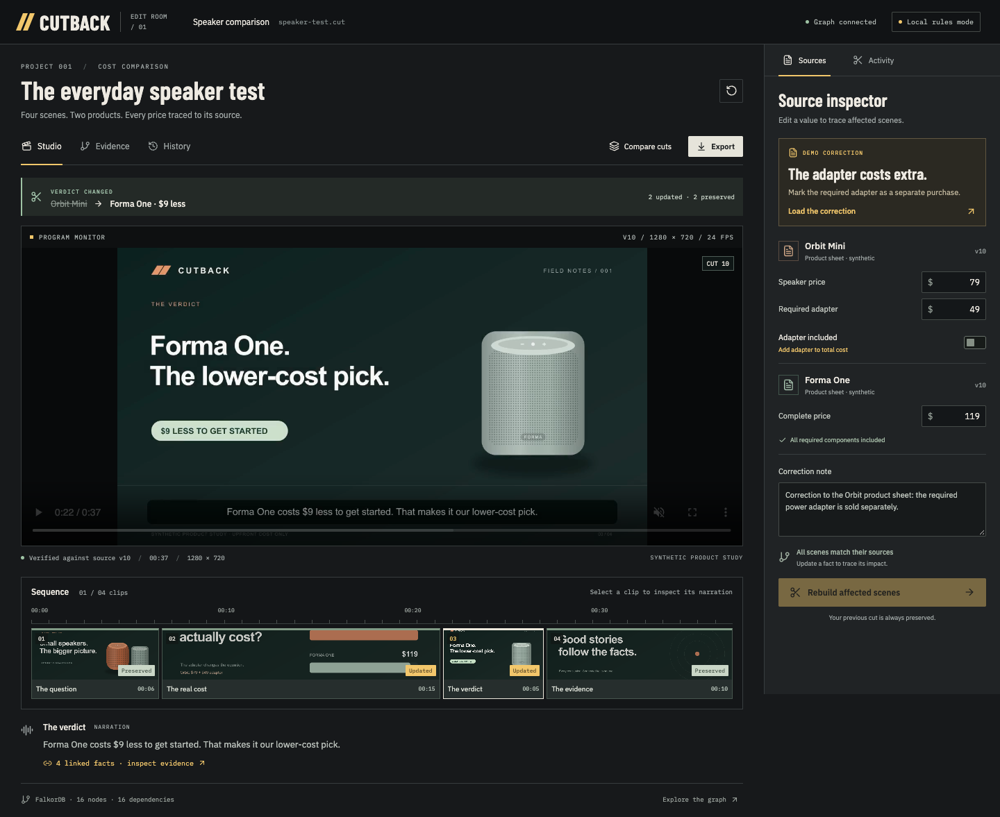
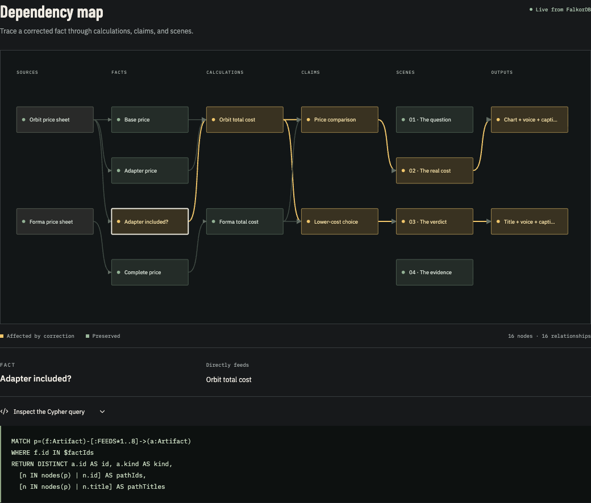
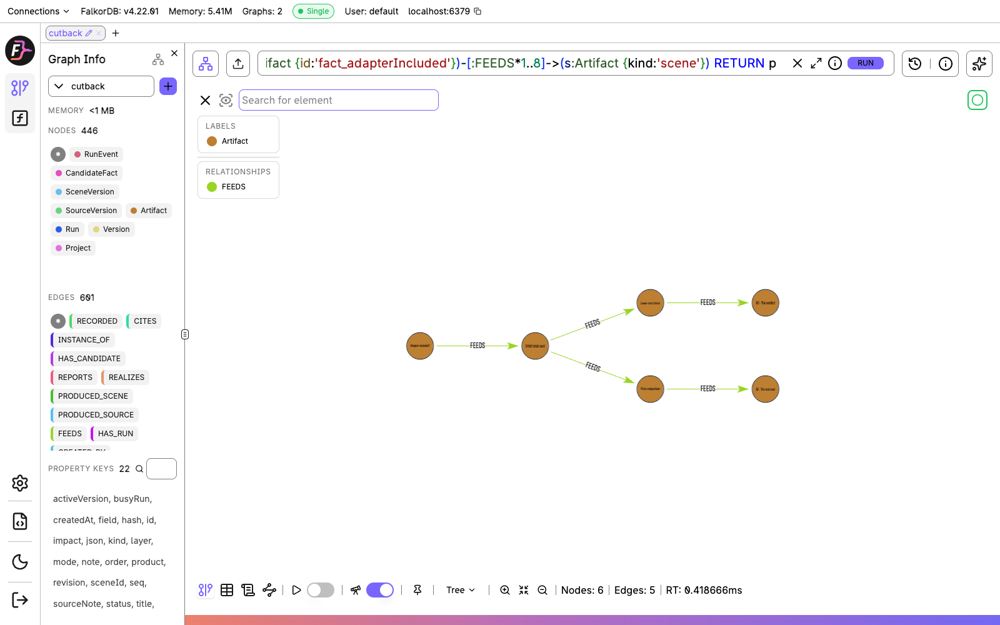
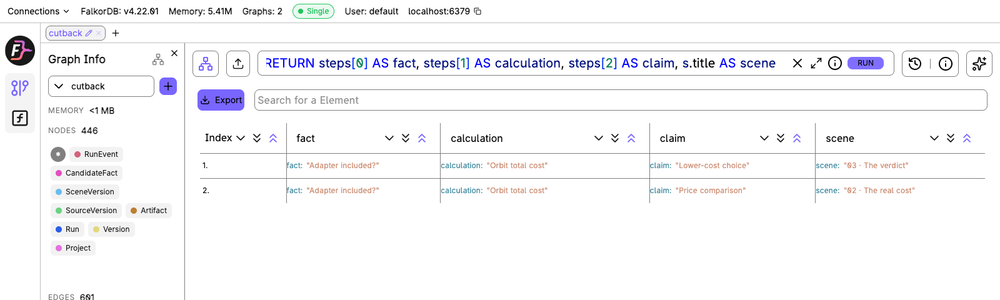
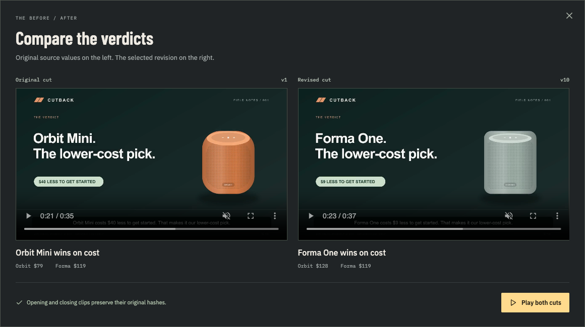
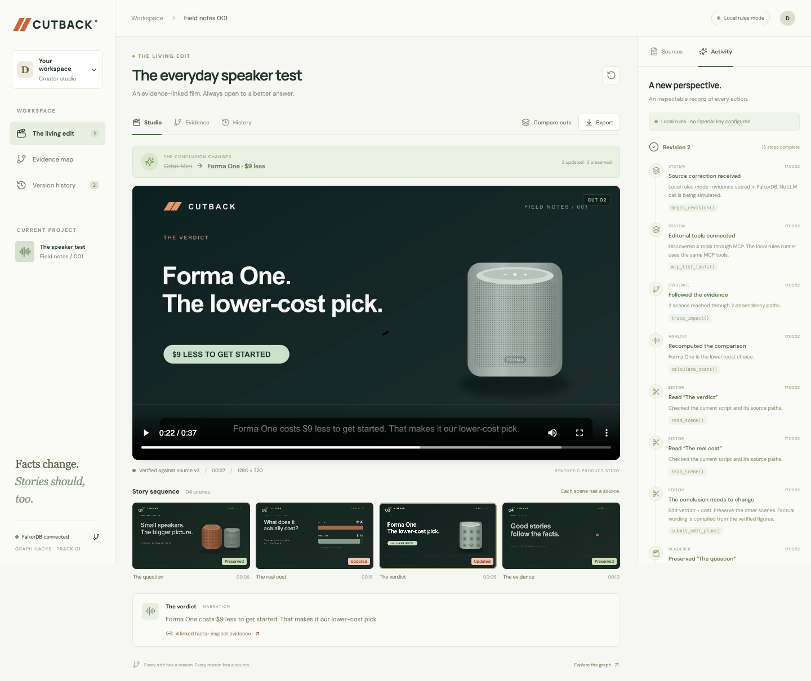

# I built CUTBACK to revise videos when their facts change

I built CUTBACK for videos whose conclusions depend on source data. It connects facts to the calculations, claims, and scenes that use them, so an editing agent can follow a correction through a finished video.

The problem is familiar in product comparisons, tutorials, and explainers. A source changes after the video is finished. Updating a number in the script is straightforward. Finding every chart, caption, and conclusion that depended on it takes more work.

For the [FalkorDB hackathon](https://www.wemakedevs.org/hackathons/falkordb), I tested this with a four-scene comparison of two fictional speakers. Orbit Mini costs $79. Forma One costs $119. The original video recommends Orbit because it is $40 cheaper.

Then I correct one source field: Orbit's required adapter is sold separately. The adapter costs $49, bringing the complete price to $128. Forma is now $9 cheaper.

CUTBACK updates the cost and verdict scenes, including their graphics, narration, and captions. The opening and closing retain their existing clips. Both versions remain available for comparison.



_The revised cut in CUTBACK. Source facts are on the right; the sequence shows the four scenes below the player._

## Turning a correction into an edit

I wanted the project to answer a few specific questions before rendering anything:

- Which scenes depend on the corrected fact?
- Does the correction change the conclusion?
- What evidence explains each edit?
- Which clips can I preserve?

I modelled the dependencies in FalkorDB:

```text
Source → Fact → Calculation → Claim → Scene → Rendered assets
```

The two product sheets supply Orbit's base price, its adapter price, whether the adapter is included, and Forma's complete price. Those facts feed the total-cost calculations. The calculations support the price comparison and recommendation, which appear in two scenes.

The opening asks the comparison question. The closing explains the scope and fictional data. Neither uses the price figures, so this correction does not reach them.

The query that finds the affected parts is:

```cypher
MATCH p=(f:Artifact)-[:FEEDS*1..8]->(a:Artifact)
WHERE f.id IN $factIds
RETURN DISTINCT a.id AS id, a.kind AS kind,
  [n IN nodes(p) | n.id] AS pathIds,
  [n IN nodes(p) | n.title] AS pathTitles
```

It starts at the changed facts and follows `FEEDS` relationships. Returning the paths gives me an explanation for each affected scene as well as the scene IDs themselves.



_The same correction reaches the cost comparison and the verdict through their calculations and claims._

The server checks the agent's edit plan against this result. If the graph returns two scenes, the plan must cover those two scenes. An integration test removes a dependency edge from FalkorDB and checks that the corresponding scene disappears from the result.

This is also where I kept the prototype small. I authored the scene model and its dependencies. CUTBACK does not yet infer those relationships from an arbitrary uploaded video.

## Inspecting the graph in FalkorDB Browser

I also opened the database in [FalkorDB Browser](https://github.com/FalkorDB/falkordb-browser), the project's visual client. It lets me run Cypher and inspect the stored nodes and relationships directly.

For my local setup, Docker exposes the database on port `6387` and the Browser on `6388`:

```yaml
ports:
  - '127.0.0.1:6387:6379'
  - '127.0.0.1:6388:3000'
```

After starting the database with `docker compose up -d falkordb`, I open `http://localhost:6388` and select the `cutback` graph. The Browser connects to `localhost:6379` inside its container; the native application uses the mapped host port, `6387`.

To inspect the adapter correction, I run:

```cypher
MATCH p=(f:Artifact {id:'fact_adapterIncluded'})
  -[:FEEDS*1..8]->(s:Artifact {kind:'scene'})
RETURN p
```

The result contains six nodes and five relationships. It follows the adapter fact through Orbit's total cost, then branches into the comparison and verdict claims and their scenes.



_The stored dependency paths in FalkorDB Browser, using the tree layout to follow the correction from left to right._

For this graph's three-step route from fact to scene, I replace `RETURN p` with a projection that gives each step its own column:

```cypher
WITH s, [n IN nodes(p) | n.title] AS steps
RETURN steps[0] AS fact,
  steps[1] AS calculation,
  steps[2] AS claim,
  s.title AS scene
```

That returns `02 · The real cost` and `03 · The verdict`, each with the path that led to it.



_The affected scenes returned by the database. The opening and closing are absent from this result._

This is a useful part of the demo because someone can inspect the query outside CUTBACK's interface and see how the edit scope was selected.

## Giving the agent a bounded editing task

I connected the editorial agent to four MCP tools: `trace_impact`, `calculate_costs`, `read_scene`, and `submit_edit_plan`.

The MCP client discovers their schemas and passes them to the OpenAI Responses API. Requested function calls are dispatched through the MCP session. The agent can trace the correction, calculate the prices, read the affected scenes, and submit a plan.

Before accepting that plan, the server checks that the required tools were used, that every affected scene was read, and that the proposed verdict agrees with the arithmetic. Prices are stored as integer cents.

I kept the narration constrained too. A script compiler inserts verified figures into narration and visual templates. The evidence supports a total-cost comparison; it does not support claims about which speaker sounds better. The agent selects an editorial plan within that scope.

The screenshots here were captured in **Local rules** mode, which uses the same MCP tools, database, and renderer with a deterministic plan. The OpenAI integration is implemented, but a live API run was still unverified when I captured these checks. In OpenAI mode, an API failure leaves the previous published cut available and marks the new revision as failed.

## Rendering the revised cut

The application uses React and TypeScript, with an Express API behind it. FalkorDB stores source revisions, run events, and video history alongside the dependency graph.

The renderer turns SVG scene layouts into PNGs with Sharp, synthesizes speech, and assembles H.264 video with AAC audio using FFmpeg. Captions are burned into the film and exported separately as SRT. Their timing is estimated within each audio segment; word-level alignment is outside the current version.

My machine did not have FFmpeg installed, so the native setup uses `ffmpeg-static`. Speech uses macOS `say` locally. The Docker image includes FFmpeg and `espeak-ng` for Linux speech, with OpenAI speech available as an optional configuration.

Each scene has a fingerprint calculated from its rendering inputs. If an identical clip already exists, the renderer can reuse it. Unaffected scenes keep their previous file paths.



_The original cut recommends Orbit by $40. The corrected cut recommends Forma by $9. These are frames from the generated MP4s._

## The cache bug that gave the wrong edit count

One repeated correction produced the right video but reported zero updated scenes and four preserved scenes.

The renderer was tracking whether FFmpeg had generated a new file during that run. The interface used that flag to decide whether a scene had changed from the previous cut.

Those conditions differ when a correction restores an older clip. If the scene changes from A to B, then back to A, the renderer can reuse cached A. The scene has still changed relative to B.

I changed the scene status to compare its fingerprint with the previous version's fingerprint. Cache reuse is logged separately. The browser checks now expect two updated scenes and two preserved scenes for the adapter correction, even when a cached clip is restored.

The fingerprint also needed a precise definition. It describes a scene's rendering inputs. To verify that preserved media files contain the same bytes, the browser checks separately calculate their SHA-256 checksums.

## Keeping a failed revision from replacing a good cut

Two requests can arrive with the same expected version number. I use a conditional update in FalkorDB to let only one request acquire the revision lock. The new version becomes active after rendering and verification succeed.

If the API restarts during a run, that run is marked as failed and the previous cut remains available. The current implementation assumes a single API process.

Startup needed similar care. When FalkorDB was unavailable, the SDK could emit a connection error before the application received a client instance to attach an error listener to. I added a TCP availability check and initialization retries so the API can report that it is not ready yet.

## The volume mount that lost earlier revisions

I found a persistence problem after recreating the database container. Earlier test revisions disappeared even though the Compose file declared a named volume and the container was healthy.

I had mounted the volume at `/data`. The image I was using wrote to `/var/lib/falkordb/data`.

Before replacing the container again, I copied the current database files into the volume and recorded the active version ID and revision count. I corrected the mount, recreated the container, and checked those values again. All six revisions present at that checkpoint survived, with the same active cut.

The native application and Docker application also use separate graph names because they have separate media stores. Otherwise, one could read a valid version record whose video files existed only in the other environment.

## The setup and recording problems

A dependency audit reported seven advisories, including two critical findings. Updating the affected packages brought npm's reported count to zero at the time of the check, but the first installation failed halfway through.

The machine had about 122 MiB free. npm reported `ENOSPC`, then `ENOTEMPTY` on a retry because the interrupted operation had left partially moved package directories. Docker also began returning I/O errors.

Clearing npm's downloadable cache recovered roughly 2.7 GB. A clean `npm ci` repaired the installation after the lockfile update. I restarted Docker, then reran the build, graph tests, and browser workflow.

The automated environment had two other limitations. I moved the browser checks to an isolated Chrome session through Playwright when the first UI automation route was unavailable. An IPC restriction in the `tsx` command was resolved by invoking Node with `--import tsx` in the relevant scripts.

Recording found another ordering bug. The walkthrough completed its interactions, then failed to save because the script closed the browser connection before calling Playwright's `video.saveAs`.

I changed the sequence to close the browser context, save the flushed recording while the connection remained available, and then close the browser. The walkthrough is silent for a voiceover; the exported comparison films contain synthesized narration. The comparison view now plays the actual verdict videos, and the exported MP4s were decoded to check the files.

## Making the interface fit the task

The first interface had a cream background, sage cards, rounded controls, and a large sidebar. I was not happy with it. The sidebar repeated navigation already available above the player, while the source controls and timeline had less room.



_The first interface. I removed the oversized sidebar and gave more space to the editing controls._

I changed it to charcoal panels, warm white text, and amber actions. IBM Plex Sans handles controls, IBM Plex Mono handles time and data labels, and Barlow Condensed is used for headings. The fonts are bundled locally.

The sequence now sizes clips by duration, and the source inspector sits beside the player on desktop. Browser checks cover the correction flow, history, playback, and the narrow mobile layout after the redesign.

## What I want to test next

CUTBACK's current scope is one authored comparison with fictional data. The next larger problem is connecting claims to evidence across more video formats, especially when a correction changes the structure of the explanation rather than a price or verdict.

For the existing demo, I can challenge the result with different adapter prices. At $40, both products cost $119 and the verdict should become a tie. At $20, Orbit's total becomes $99 and it should win again. The same two scenes should change in each case.

I built this for the hackathon's **Agents That Act on Connected Data** track. The part I want viewers to inspect is the full path from a corrected source fact to an edit: the query that selects the scenes, the calculation behind the new verdict, and the video files that show what changed.
