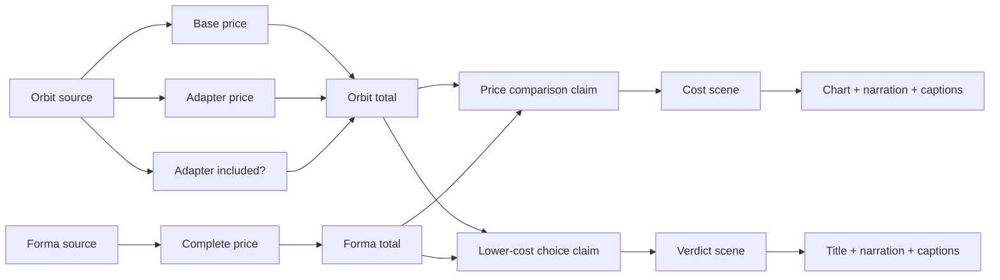

# The graph is the edit decision

Track: **Agents That Act on Connected Data (Track 1)**.

The application has no in-memory replacement for FalkorDB. Removing the database prevents source loading, impact analysis, agent execution, version selection, and committing a new cut. Rendered media on disk is a content-addressed cache, not a second knowledge database.

## Dependency graph



Each item is an `Artifact` node with `id`, `kind`, `title`, `layer`, and `order`. Directed `FEEDS` edges represent dependencies. The opening and closing scenes are also nodes but do not depend on pricing facts.

The topology is an explicitly authored model for this comparison, not an LLM guess. Extending the product to new editorial templates requires defining their dependency graphs.

## Immutable revisions and agent state

| Node            | Properties / purpose                                                  |
| --------------- | --------------------------------------------------------------------- |
| `Project`       | Current revision, active version, and a compare-and-set render lock   |
| `Run`           | Revision, execution mode, status, source note, graph impact           |
| `CandidateFact` | Field name and JSON scalar value; belongs to one run                  |
| `RunEvent`      | Ordered tool invocation / rendering / verification events             |
| `SourceVersion` | Immutable source note, product, and revision                          |
| `SceneVersion`  | Scene script, render fingerprint, and scene ID                        |
| `Version`       | Published immutable cut manifest, exact evidence, results, and checks |

Relationships:

```text
Project -HAS_RUN-> Run -HAS_CANDIDATE-> CandidateFact -INSTANCE_OF-> Artifact
Run -RECORDED-> RunEvent
Run -PRODUCED_SOURCE-> SourceVersion -REPORTS-> CandidateFact
Run -PRODUCED_SCENE-> SceneVersion -REALIZES-> Artifact
SceneVersion -CITES-> CandidateFact
Project -HAS_VERSION-> Version -CREATED_BY-> Run
```

Cut manifests retain JSON representations for convenient API responses. Native edges remain authoritative for traversals, the source/citation relationships, and determining affected scenes. Calculation tools re-read the run's facts through the graph before computing and again during verification.

## The essential queries

See [queries.cypher](queries.cypher). The executable constants are in `server/graph-model.ts`; parameterized queries and persistence are in `server/store.ts`.

The central query walks `FEEDS` paths from changed fact nodes, returning both affected artifacts and the paths that explain the selection. It returns `cost` and `verdict` for an adapter-inclusion correction. The integration test deletes a dependency edge and verifies that the edit selection changes accordingly.

## Concurrency and failures

A run starts only when `Project.revision` equals the requested revision and `busyRun` is empty. This comparison and lock acquisition happen in one graph query. Only the owning run can publish the next revision. The previous version remains active until rendering and verification succeed.

After an API process restart, unfinished runs are marked failed and their locks released. They are not silently resumed. The user can retry from the still-active prior cut. This prototype runs one API process; it does not claim distributed-worker recovery or multi-tenant isolation.
